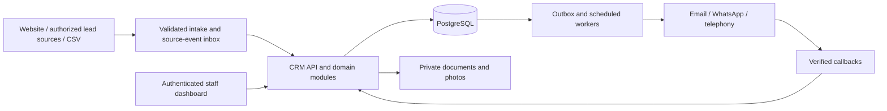

# Hutāśana CRM — Product and Technical Design

Date: 28 October 2026. Status: proposed design for a new private repository. Companion: [PRD](./PRD.md), [implementation roadmap](./IMPLEMENTATION.md).

## 1. Architecture decision

Propose a standalone responsive Next.js/TypeScript application with a modular backend, PostgreSQL, private object storage and durable background jobs. Reuse the team's web-stack familiarity, not the marketing site's deployment or authentication assumptions. This is a recommendation, not an approved hosting/provider purchase.

Keep the public website on its existing domain. A future `crm.hutashana.com` deployment has independent secrets, database, access control, backups and releases. Website enquiries enter through a validated public intake endpoint. Existing website enquiry flow currently opens WhatsApp; it does not create a CRM lead, so changing intake must be an explicit integration task.

Use one deployable domain application initially. Modules expose explicit service interfaces; avoid independent microservices until load or organizational ownership justifies them. Long-lived calls and scheduled work run outside web request lifetimes.

## 2. User experience

Navigation: Today, Leads, Clients, Projects, Quotations, Invoices & Payments, Catalog & Rates, Tasks, Reports, Settings. Procurement, installation and service appear as their releases become available.

Today shows actionable items: unassigned leads, overdue follow-ups, quotes needing approval, due balances, disputed payments and blocked installations. Display stage and owner, not only counts.

Quote workspace: customer/site header; zone/module list; measurement and configuration editor; live commercial summary; internal cost/margin panel with permissions; clauses and exclusions; revision history and PDF preview. Brand → series → model/specification → compatible size filters replace a single overwhelming product dropdown. Warn visibly when dimensions are provisional or compatibility is unverified.

Client workspace: contacts and consent, separate project tabs, communication timeline, documents, billed/paid/outstanding figures, unapplied advances, promised payments and next task. Installation staff get a mobile task-first view with photo upload, readiness checklist and snag updates.

Issued PDFs show Hutāśana identity, customer/billing/site details, item specifications and units, commercial totals, terms, validity, revision/document number and acceptance area. Internal purchase costs and margins never appear in customer documents. Store generated PDFs privately with short-lived authorized download links and versioned templates.

## 3. Domain model

| Aggregate | Main records and invariants |
|---|---|
| Organization/access | Organization, user, membership, role, permission; tenant/organization checked on every protected operation |
| Customers | Customer, contact, address, consent record; one customer can have several projects |
| Leads | SourceEvent, enquiry/opportunity, attribution, task, activity; provider event ID unique within source/account |
| Product catalog | Brand, supplier, category, product, variant, unit, compatibility rule, warranty reference |
| Pricing | PriceBookVersion, price entry, formula version, discount policy; published versions retained |
| Estimation | SurveyVersion, zones, module configuration, Quote, QuoteRevision, QuoteLineSnapshot, clause snapshots |
| Contract | Acceptance, sales order, approved change order; identifies exact quote revision and attachments |
| Billing | Invoice, issued line snapshot, credit note, receipt, allocation, refund/reversal, milestone |
| Fulfilment | BOM snapshot, purchase order, goods receipt, production task, dispatch, installation, snag |
| Service | Handover, warranty coverage, claim, appointment and resolution |
| Automation | OutboxEvent, job, delivery attempt, suppression, promise-to-pay, call session, agent outcome |
| Audit | Actor, action, organization, object, time, reason and before/after or event reference |

Represent a customer contact separately from a lead/opportunity: one phone number may enquire about two sites. Merge contacts through reviewed operations with reversible links; never discard source events.

## 4. Pricing and measurement engine

Perform all commercial calculations server-side using decimal arithmetic or integer minor currency units with explicit quantity precision. Never use binary floating point for financial totals. Store currency, unit, formula version, rounding policy and tax configuration version on each snapshot. Use a decimal database type for dimensions/quantities where appropriate.

Supported formula families:

- Piece/pair/set: quantity × rate for that exact SKU and unit.
- Running length: normalized length converted to the quote's declared billable unit × rate.
- Elevation area: explicitly chosen billable width × height converted to area × rate; exclusions and rounding separately declared.
- Module package: approved module base plus priced upgrades and extras; included components cannot be counted again as accessory lines.
- Custom line: explicit unit/quantity/rate with permission and reason.

Do not derive production board quantity, cut list or sheet wastage from customer-facing elevation area alone. BOM generation requires construction rules including sides, backs, shelves, shutters, edge banding and allowances. Initial release provides an estimator-reviewed BOM; automatic cutting optimization is future scope.

Illustrative arithmetic, not commercial rates: width 2400 mm × billable height 750 mm = 1.8 m²; 1.8 × 10.7639104167 = 19.37503875 ft². At an explicitly fictional ₹1,000/ft², unrounded extension is ₹19,375.03875. A policy rounding the line to paise yields ₹19,375.04 before discounts/tax. Running length for the same 2400 mm is about 7.874 ft and must not be charged using an area rate.

Calculation order proposal: resolve quantities → line extensions → allowed discounts apportioned by line → approved taxable ancillary charges → applicable line tax → totals → documented final rounding adjustment. Accountant confirms tax basis and statutory rounding before implementation. Margin = (net selling amount excluding tax − comparable estimated cost) / net selling amount excluding tax; handle zero selling amount explicitly. Markup uses cost as denominator and must have a different label.

Hardware rules have brand/series/version, dimension range, depth clearance, compatible board thickness, load and required accessories. A missing rule produces 'technical review required', not 'compatible'. Supplier or manufacturer documents back each rule. Staff approval is mandatory for unverified substitutions.

API: `calculateQuote(configuration, priceBookVersion, formulaVersion)` returns normalized quantities, amounts, warnings, price provenance and internal margin data filtered by role. It does not issue documents or send messages. AI can prepare configuration drafts but cannot supply final rates, compute authoritative totals or waive validation.

## 5. States and immutability

Quotation revision: draft → internal review → approved for sharing → shared → accepted/rejected/expired/superseded. Editing shared content forks a new revision. Acceptance checks revision status and records evidence. Accepted revisions remain readable even if products are retired.

Invoice: draft → issued → partially paid/paid; void/cancellation or credit adjustment follows approved business/accounting rules. Payment status is derived from allocations, not an editable label. Separate delivery state (queued/sent/failed) from financial state. Use row locks/transactions and unique numbering constraints to prevent concurrent issue collisions.

Receipt: pending verification → confirmed → partially/fully allocated; reversals reference original entries. Gateway event identity and gateway payment identity have separate unique constraints. Multiple different events for the same payment must not post multiple receipts. Browser success screens and uploaded screenshots do not count as confirmed payment.

## 6. Integrations and reliability

Each external adapter maps provider data into validated internal events. Verify signatures using raw body where required, validate payloads, store source event idempotently, acknowledge promptly after durable storage, and process asynchronously. Retry transient failures with backoff and dead-letter failures for staff review. Scheduled reconciliation repairs missed events where provider APIs permit it.

Website endpoint has origin-aware abuse controls, rate limits, validation and bot protection; a public frontend must never contain a server integration secret. Record intake before offering WhatsApp continuation, show a clear success/failure state and preserve the existing lead channel during rollout.

Meta: validate app permissions, Page/business ownership, app review needs, token lifecycle, webhook subscription and real lead retrieval in a spike. Official retrieval documentation was rate-limited during research; exact current permissions/limits remain an implementation prerequisite.

Justdial: obtain written API/CRM export details from Hutāśana's account representative. Availability, authentication, payload, entitlements and lead ownership are unverified. Start with authorized CSV/manual imports; do not promise automatic scraping or a public API.

Email: transactional delivery provider, verified sending domain, delivery/bounce/unsubscribe handling and event tracking. WhatsApp: official Business Platform/provider, approved applicable templates, permission evidence and stop handling. Current `wa.me` links do not provide automated delivery/collection tracking.

Payment provider is selected after evaluating settlement, reconciliation and fee requirements. Razorpay is an example integration, not a purchase decision. Match provider payments to invoices and reconcile against bank settlements separately from receipt confirmation.

## 7. Reminder scheduler

A committed financial/business event creates an outbox record in the same database transaction. Workers schedule policy-versioned reminders with organization, customer, invoice, channel and purpose. Deterministic business keys prevent duplicates across retries. Before dispatch, re-read current balance, recent receipts, disputes, channel permission, contact caps and cancellation state. Coordinate claim/send with concurrent payment updates; acknowledge the unavoidable external send race and keep rechecks as close as possible to provider submission.

Uncertain provider timeout: store an unknown delivery state and reconcile using provider status/idempotency capabilities before resending. Exactly-once external delivery is not guaranteed. A failed WhatsApp template does not automatically authorize a voice call. Each channel has its own eligibility and fallback policy. Show unsuccessful attempts to staff.

Store timestamps in UTC; business dates and contact windows evaluated in Asia/Kolkata by default. Owner-approved quiet hours, maximum attempts and minimum spacing apply across channels. Stop/pause/dispute requests propagate to all relevant pending jobs.

## 8. Voice architecture

Telephony provider handles Indian calling infrastructure and routing; a separate voice conversation service performs speech recognition, turn-taking, synthesis and constrained tool calls. Provider comparison/pilot must evaluate India outbound eligibility, caller IDs, disclosure, transfer, language quality, interruptions, latency, recordings, retention and total per-minute cost. No provider is selected in these documents.

Call lifecycle: eligible → queued → dispatch recheck → dialing → connected → identity check where needed → conversation → completed/transferred/failed → structured outcome reviewed where uncertain. Store provider call ID, policy version, timestamps, language, summary, outcome, tasks, permission references and protected recording pointer when recording is enabled.

Approved tools: get current authorized invoice summary; request a callback; propose/book an available appointment with explicit confirmation; record a promise-to-pay; create a dispute/service task; stop communications; transfer to staff. Financial tools are read-only for agents. No refunds, invoice editing, write-offs, discounts, order substitutions or collection threats.

Example payment script: identify Hutāśana and automated assistant → confirm recipient without exposing balance → ask whether now is convenient → retrieve current invoice summary → ask about expected payment date → repeat confirmed date → create promise-to-pay → offer approved payment-link message if eligible → close. Wrong person, disputed amount, reported payment, distress, uncertainty or requested human contact triggers a task/transfer and applicable suppression. Never request OTP, card credentials or bank passwords.

## 9. Security and operations

Use established authentication with MFA for privileged users; role and organization checks in service/API layers; scoped service accounts; encrypted transport; managed secrets; private file storage; restricted exports; short-lived customer links; audit logs and access reviews. AI retrieval is permission-filtered. Imported notes, emails and transcripts are untrusted data and cannot instruct tools to change permissions or send arbitrary data.

Back up database and files; test restore before pilot. Proposed pilot recovery objectives: at most 24 hours data loss and restore within one working day; owner approves and hosting must meet them. Retention/deletion design distinguishes financial records from lead/contact recordings, with accountant/legal input for applicable requirements. Monitor job failures, webhook signature failures, missed syncs, outbound complaints, invoice numbering, reconciliation drift and document generation failures. Alert owners without exposing private customer content in logs.

## 10. Research register

Sources checked 28 October 2026. These establish specific product constraints, not the prevalence of Hutāśana's internal problems. Workflow pain-point mapping is an inference requiring interviews and historical-document validation.

| Source | Finding and design implication | Confidence / limitation |
|---|---|---|
| [Blum Cabinet Configurator](https://www.blum.com/gb/en/services/planning-construction-product-selection/cabinet-configurator/) and [technical catalog](https://publications.blum.com/2022/catalogue/id/331/) | Cabinet/hardware planning depends on product-specific dimensions and construction information; preserve exact product and compatibility evidence | Primary manufacturer sources; catalog example is older, so verify current local SKU documents |
| [Razorpay webhook best practices](https://razorpay.com/docs/webhooks/best-practices/) | Duplicate/retried events are expected; financial processing must be idempotent and recoverable | Primary, directly read; provider-specific details apply only if selected |
| [WhatsApp Business Messaging Policy](https://business.whatsapp.com/policy) | Permission, applicable message/template rules and opt-out handling influence outbound automation | Primary, directly read; recheck at launch and with chosen provider |
| [TRAI UCC guidance](https://www.trai.gov.in/what-spam-or-ucc) | Consent/preferences and registered commercial communication matter for outbound calls/messages | Primary guidance; obtain provider confirmation of exact current routing/registration obligations before voice launch |
| [CBIC GST Rule 46](https://taxinformation.cbic.gov.in/content-page/explore-rules/1000136/1000001) | Statutory invoice particulars must be addressed in billing discovery | Official search excerpt found; full page fetch failed. Accountant must verify current full rules, tax classification, e-invoice applicability and numbering requirements |
| [Meta official lead retrieval guide](https://developers.facebook.com/docs/marketing-api/guides/lead-ads/retrieving/) | Reference entry point for connector spike | Fetch returned HTTP 429; exact current implementation requirements not verified |
| Justdial CRM/API access | Integration must be commercially confirmed | No adequate first-party technical documentation verified; account representative confirmation required |

No market-rate estimates, supplier warranties, empirical customer conversion uplift, live platform fees or implementation guarantees are asserted by this research.
